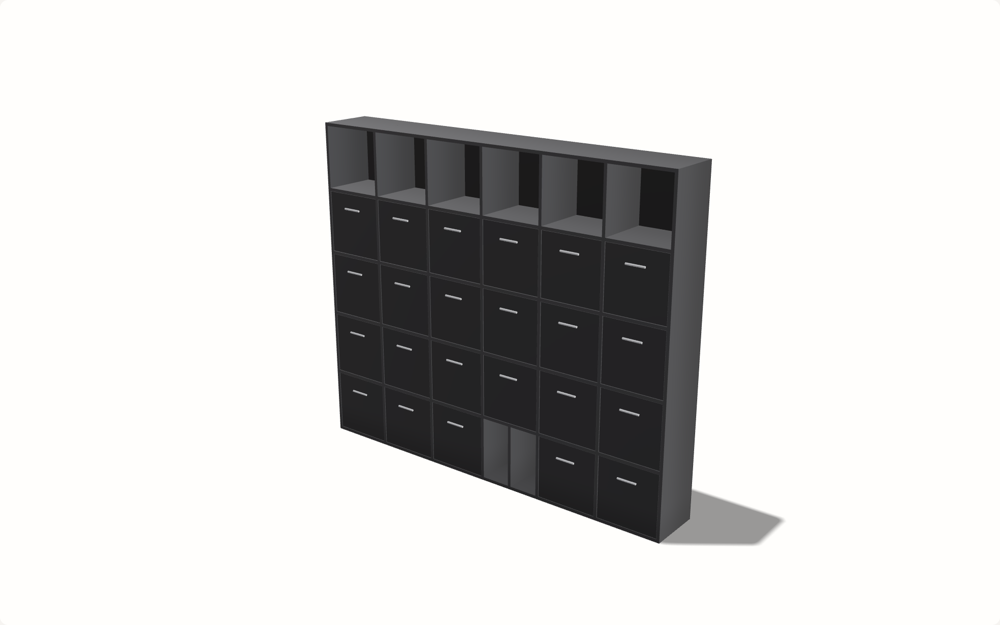

# Dowel

A 3D configurator for a modular shelving system. The visitor assembles a unit
from modules on a grid, changes its dimensions and finish, watches the price
update, and shares the result as a link that restores the exact build.

Dowel is a fictional company. This is a demonstration project and nothing here
is for sale.

> Phase 4 of five. The domain, the API, the scene and the configurator are
> done; the performance and accessibility pass follows, and this file gets the
> live link in Phase 5.

## What is server-authoritative

The client never computes a price and never decides whether a configuration is
legal. It sends a configuration; the server validates it against the
compatibility rules and returns the price. The rules live in one module, the
resolver imports it, and the resolver's answer is the only one that counts — a
mutation carrying an impossible configuration is rejected there, not in the UI.

## Two details worth naming

**The canvas's text alternative is generated on the server, from the same
configuration the geometry is built from.** `Configuration.description` is a
field of the API, not a string assembled in the component — so the sentence a
screen reader hears cannot drift from the unit that is drawn. It updates
because it is part of the same answer as the price.

**No float touches a price.** Money is integer pence and a finish multiplier is
basis points, where 10000 is ×1, so the arithmetic stays in integers and rounds
exactly once — at the end, on the only division in the calculation. Nothing in
the API carries a rounded decimal, and nothing accumulates an error per module.

## The product

A unit is a grid: 2 to 6 columns, 2 to 5 rows, in oak, charcoal or white. Every
bay holds one module or is left open.

| Module | Occupies | Rule |
| --- | --- | --- |
| Open shelf | 1 bay | — |
| Drawer | 1 bay | not in the top row |
| Door | 2 bays, vertically | cannot start in the top row |

A unit over 4 columns wide keeps the centre bay of its bottom row for a centre
support. A unit may not be entirely empty.

Saving is content-addressed: the canonical form of a configuration is hashed,
the hash is unique, and saving a build that already exists returns the link it
already has. The same build always has the same link, including when two people
assemble it in a different order.

Coordinates count from the bottom left, so row 0 stands on the floor. Prices
are integer pence and finish multipliers are basis points, applied once to the
subtotal, so the whole calculation has one rounding step.

## Stack

| Concern | Choice | Why |
| --- | --- | --- |
| Framework | Next.js 16, App Router | The GraphQL server is a route handler in the same app: one deploy, no separate service. |
| Language | TypeScript, `strict` + `noUncheckedIndexedAccess` | Grid indexing is the core of this domain, and unchecked index access is exactly how that goes wrong. |
| Styling | Tailwind 4, theme as CSS custom properties | No component library for the interface chrome. |
| GraphQL server | GraphQL Yoga, route handler at `app/api/graphql` | Fetch-API native, so it runs as a Next route handler unmodified. |
| GraphQL client | None — generated typed documents and a `fetch` wrapper | Three operations, one view, nothing to cache or normalise. A client library would also break the first-load budget twice over. See `DECISIONS.md`. |
| Types | graphql-codegen, schema-first | Types are generated from the SDL and committed; CI fails if they are stale. Documents are emitted as typed strings, so no part of `graphql` reaches the client. |
| ORM | Prisma 7 with `@prisma/adapter-pg` | Plain connection strings. Pooled for requests, direct for migrations. |
| Database | Neon Postgres | |
| Unit tests | Vitest | |
| Browser tests | Playwright | |
| CI | GitHub Actions | Type check, lint, generated-types freshness, unit, build, bundle budget, browser tests. |
| Deploy | Vercel | |

## Running it

```sh
nvm use                 # Node 22
npm install             # also generates the Prisma client
cp .env.example .env.local   # then fill in the two Neon connection strings
npx prisma migrate deploy
npm run dev
```

The GraphQL endpoint is at `/api/graphql`.

## Scripts

| Script | What it does |
| --- | --- |
| `npm run typecheck` | `tsc --noEmit` |
| `npm run codegen` | Regenerates `lib/graphql/generated` from the SDL |
| `npm run codegen:check` | Regenerates into a temporary copy and fails if the committed types differ. Asks no questions of git, so an uncommitted-but-correct file is not reported as stale |
| `npm test` | Vitest: the rules, the pricing table, the id encoding, and the resolvers through the real schema |
| `npm run test:e2e` | Playwright against a local production build |
| `npm run measure:bundle` | Starts `next start`, loads the landing route in headless Chromium, and sums the gzipped bodies of every script it fetched. Fails over 150 KB. |

## Measured numbers

Filled in as each phase produces them. Every figure names the instrument that
produced it.

| Measurement | Value | Instrument | Date |
| --- | --- | --- | --- |
| First-load JS, landing route, gzipped | 137.9 KB, budget 150 KB | `npm run measure:bundle` — headless Chromium against `next start`, summing the response bodies of every script the page fetched | 2026-11-13 |
| 3D in the landing route | none | the six chunks that figure covers are the complete set the route requests; no `three`, `@react-three/fiber` or `drei` among them | 2026-11-13 |
| Everything the 3D view downloads | 549 KB (408 KB JavaScript, 128 KB environment map) | `npm run measure:scene-payload` | 2026-11-13 |
| Draw calls, smallest unit | 10 | `npm run measure:scene` — `WebGLRenderer.info.render`, headed Chromium on ANGLE Metal / Apple M1 | 2026-11-13 |
| Draw calls, doors and drawers | 18 | as above | 2026-11-13 |
| Draw calls, largest unit (6 × 5, 29 modules) | 15, budget 30 | as above | 2026-11-13 |
| Frame rate, desktop retina, orbiting and resizing | 60.0 fps, 0 dropped frames | as above; the `requestAnimationFrame` ceiling was 60.4 fps, so the scene is at the ceiling | 2026-11-13 |
| Frame rate, phone viewport at dpr 3, 4× CPU slowdown | 60.0 fps, 0 dropped frames | as above; the throttle verified at a measured 4.13× on a fixed workload | 2026-11-13 |
| The scene's own work per frame, throttled | 0.1 ms median, 0.9 ms worst | as above — the figure a display cap cannot hide | 2026-11-13 |

### What these numbers do not say

The GPU is doing forty times the work the CPU is, and it scales with pixels. A
4× CPU slowdown therefore does not simulate a weak GPU — the expense on a phone
is fill rate, the filtered environment map and the variance shadow map, and a
CPU throttle touches none of them. "60 fps under 4× on an M1" says nothing
about a mid-range Android, where the same 1.67 ms could be 8–17 ms.

Every figure above comes from one machine, an Apple M1. Numbers from real
devices belong here and outrank them.

## The scene



Every panel is generated from the configuration. There is no model of a shelf
in this repository, because a model cannot change its own dimensions.

- **One `InstancedMesh` per part type**, allocated once and never reallocated.
  Changing the configuration writes instance matrices; it does not touch the
  scene graph. Draw calls follow the number of part *types* in use, not the
  number of parts — which is why the largest unit draws in fewer calls than the
  one with doors.
- **Lit by an environment map**, not by a pile of lights, with ACES filmic tone
  mapping, plus one directional light whose job is the shadow on the floor.
- **Occlusion is computed from the geometry** rather than from the depth
  buffer: a bay is a box open towards the viewer, so depth into the unit is
  how dark a fragment is. Two `smoothstep`s, no post-processing pass.
- **The camera is constrained**: it cannot go under the floor, cannot look
  straight down, and cannot swing behind the unit.
- **Nothing moves unless you move it.**

## Decisions

`DECISIONS.md` carries one entry per non-obvious choice, dated.
