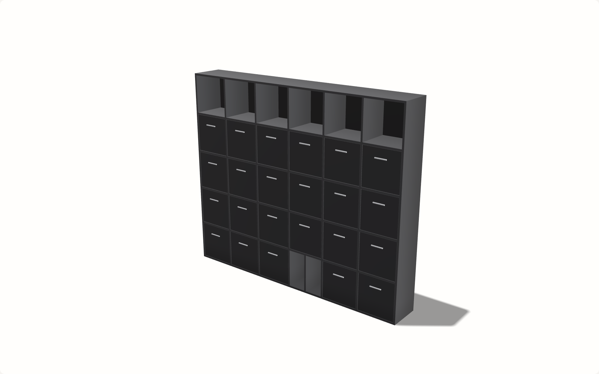

# Dowel

A 3D configurator for a modular shelving system: assemble a unit from modules
on a grid, change its dimensions and finish, watch the price update, and share
the result as a link that restores the exact build. Three.js front end, GraphQL
API, **pricing and validation on the server**.

**Live:** https://dowel-configurator.vercel.app

Dowel is a fictional company. This is a demonstration project and nothing here
is for sale.



---

## Status

**Phases 1 to 5 of five are done.** The site is deployed, measured and checked
against its live URL on every push to main. What is still open is listed at the
bottom of this section rather than left unsaid.

### Measured on the deployed site

| | | Instrument |
| --- | --- | --- |
| Lighthouse performance, mobile | **100** (worst run 99) | `npm run measure:lighthouse` — Lighthouse 13, mobile profile, median of 5 runs against the live URL |
| Lighthouse accessibility | **100** | as above |
| Lighthouse best practices | **100** | as above |
| Lighthouse SEO | **100** | as above |
| axe violations, three states | **0** | `npm run check:a11y` — axe-core, WCAG 2.2 A and AA, against the live URL |
| Deployed check | **8 of 8** | `npm run check:deployed`, in CI on every push to main |

The three axe states are the landing route before the configurator is asked
for, the same route with it mounted, and a share link — three different
documents, so scanning only the first would be scanning the one with almost
nothing in it.

The deployed check asserts, against the real URL: the document is
server-rendered, the page hydrates, the API answers, **the API can reach
Postgres as a separate assertion**, a configuration prices to a known total, a
save round-trips, and a share link previews the build rather than the site.

That separate database assertion exists because of a real failure: this site
was live and answering for two days with `database: false`, the Vercel project
having no connection string, and nothing in CI knew. Local verification is not
verification.

### Still outstanding

Nothing here blocks the site working. They are the items that would be next.

- **Bundle analysis.** The first-load figure is measured in a browser and
  enforced in CI, but nobody has sat down with a treemap of the lazy chunk to
  see what the 408 KB of JavaScript behind the boundary actually consists of.
- **Disposal verification.** Geometries, materials and instanced meshes are
  disposed on unmount, and the measurement hook can mount and unmount the
  canvas on demand — but the twenty-cycle memory check the brief asks for has
  not been run, so the claim is "disposal is implemented", not "disposal is
  proven".
- **Ambient occlusion is approximate.** It is computed from position — depth
  into the unit, height above the floor — rather than from the depth buffer.
  It costs nothing measurable and buys most of the effect. A real screen-space
  pass would be better and has not been attempted.
- **One unresolved failure.** drei's `ContactShadows` renders nothing in this
  scene, and so did the same technique written by hand. The floor plane drew,
  the render target worked, and an orthographic capture from under the floor
  came back empty under two camera formulations. The frustum-culling
  hypothesis was tested and rejected. The cause is unknown and recorded as
  unknown in `DECISIONS.md`; what ships is Three's shadow mapping, which works.
- **No real device has been measured.** Every frame-time figure comes from one
  Apple M1. See [What the numbers do not say](#what-the-numbers-do-not-say).

## What is server-authoritative, and why

**The client never computes a price and never decides whether a configuration
is legal.** It holds a configuration, sends it to the server, and renders what
comes back — a price, or the rules the unit breaks with the bays they are
about.

The reason is in the threat model rather than in tidiness: assume the client is
hostile. A mutation carrying an impossible configuration is rejected by the
resolver, not by the interface, so a client that skips the interface entirely
and posts the mutation gets the same answer. There is a test for exactly that.

Validation lives in **one module**, imported by the resolver that prices, the
resolver that saves, and the tests. A saved build is validated **again on
read**: a row could have been written by an older build or edited by hand, and
an impossible unit must not be priced as though it were legal.

An invalid configuration is **not an error**. It arrives in `data` as a union
member carrying the rule code, a message written for a person, the bays at
fault and the index of the module responsible:

```graphql
union PriceConfigurationResult = PricedConfiguration | InvalidConfiguration
union SaveConfigurationResult  = SavedConfiguration | InvalidConfiguration
```

The rule, in one line: **a failure the visitor can resolve by changing their
configuration is data; absence is null; everything else is a typed GraphQL
error.** `DECISIONS.md` audits every field against it.

---

## The product

A unit is a grid: 2 to 6 columns, 2 to 5 rows, in oak, charcoal or white.

| Module | Occupies | Rule |
| --- | --- | --- |
| Open shelf | 1 bay | — |
| Drawer | 1 bay | not in the top row |
| Door | 2 bays, vertically | cannot start in the top row |

A unit over 4 columns wide keeps the centre bay of its bottom row for a centre
support. A unit may not be entirely empty.

Saving is **content-addressed**: the canonical form of a configuration is
hashed, the hash is unique, and saving a build that already exists returns the
link it already has. The same build always has the same link, including when
two people assemble it in a different order.

---

## Stack, and the choices worth explaining

| Concern | Choice |
| --- | --- |
| Framework | Next.js 16, App Router |
| Language | TypeScript `strict` + `noUncheckedIndexedAccess` |
| Styling | Tailwind 4, theme from CSS custom properties. No component library |
| 3D | React Three Fiber, with the geometry and instancing written against the Three.js API directly |
| GraphQL server | GraphQL Yoga, a route handler in the same app |
| GraphQL client | None — see below |
| Types | graphql-codegen, schema-first, committed and checked for staleness in CI |
| ORM | Prisma 7 with `@prisma/adapter-pg` |
| Database | Neon Postgres |
| Tests | Vitest, Playwright |
| CI | GitHub Actions, with a Postgres service container |

### No GraphQL client library

urql with its React bindings is 12–16 KB gzipped and reaches the network
through parsed documents, so it brings `graphql` with it — another 40 KB or so.
Against the remaining first-load budget that was the whole allowance spent
before a single control existed.

The arithmetic only confirmed a decision available on the merits: a client
library earns its weight through a normalised cache, entity sharing across
views, optimistic updates and subscriptions. This application performs three
operations on one view with nothing shared between them and nothing to
invalidate.

What replaced it is graphql-codegen's client preset and one function. Every
operation is checked against the SDL at build time, so a mistyped field is a
build failure; `request(PriceConfiguration, { input })` returns the type that
operation returns. `documentMode: "string"` means a document is its query text,
so **no part of the `graphql` package reaches the browser**.

### The landing route is server-only, with one lazy boundary

The landing route renders as server components. A single dynamic import brings
in the configurator, the GraphQL client and the entire 3D view together, and it
does not begin until the visitor asks.

Decided before any of it was written, because it is a decision about page
composition and retrofitting it means rewriting the page. A visitor who reads
the page and leaves downloads none of it.

### Money is integer pence, and the finish multiplier is basis points

No float touches a price. Prices are integer pence; a finish multiplier is
basis points, where 10000 is ×1, applied **once** to the subtotal rather than
per line — so the whole calculation contains exactly one rounding step.

The catalogue prices were then changed from round numbers to realistic ones,
because with a frame at 18000 and bays at 2200 every subtotal was a multiple of
200, every multiplier divided it exactly, and the rounding step was dead code
no test could distinguish from its absence.

### The canvas is a view of the controls, not the way in

Every configuration action is reachable from a table of bays and three radio
groups — the same controls a keyboard or a screen reader uses. The canvas's
text alternative is `Configuration.description`, a field of the API generated
from the same configuration the geometry is built from, so the sentence a
screen reader hears cannot drift from the unit that is drawn. The same sentence
is the share link's Open Graph description.

---

## Measured numbers

Every figure names the instrument that produced it. Nothing here is estimated.

| Measurement | Value | Instrument |
| --- | --- | --- |
| First-load JS, landing route, gzipped | **137.9 KB**, budget 150 KB | `npm run measure:bundle` — headless Chromium against a production server, summing the response bodies of every script the page actually fetched |
| 3D in the landing route | **none** | the chunks that figure covers are the complete set the route requests |
| Everything the 3D view downloads | **549 KB** (408 KB JavaScript, 128 KB environment map) | `npm run measure:scene-payload` |
| Draw calls — smallest unit | **10** | `WebGLRenderer.info.render`, headed Chromium on ANGLE Metal, Apple M1 |
| Draw calls — doors and drawers | **18** | as above |
| Draw calls — largest unit, 6 × 5, 29 modules | **15**, budget 30 | as above |
| GPU time per frame, desktop retina (4.4 Mpx) | **4.06 ms** median, 5.9 ms worst, against a 16.7 ms budget | `EXT_disjoint_timer_query_webgl2` |
| GPU time per frame, phone viewport (2.96 Mpx) | **1.67 ms** median | as above, on an M1 |
| CPU time per frame | **0.10 ms** median | `performance.now()` — this is the cost of *issuing* a frame, not drawing it |
| Frame rate, orbiting and resizing | **60.0 fps, 0 dropped frames** | counted from rendered frames; the animation-frame ceiling was 60.4 fps, so the scene is at the ceiling |
| Unit and integration tests | **163** | Vitest |
| Browser tests | **20** | Playwright |

The largest unit draws in **fewer** calls than the mixed one, because the count
follows the number of part *types* in use rather than the number of parts. One
`InstancedMesh` per part type is allocated once and never reallocated;
changing the configuration writes instance matrices and does not touch the
scene graph.

### What the numbers do not say

The GPU is doing forty times the work the CPU is, and it scales with pixels. A
CPU throttle therefore **does not** simulate a weak GPU — the expense on a
phone is fill rate, the filtered environment map and the variance shadow map,
and a CPU throttle touches none of them. The same 1.67 ms could be 8–17 ms on a
mid-range Android, which is at or past the frame budget.

Every figure above comes from one Apple M1. **No real device has been
measured.** Numbers from one belong here and would outrank these.

---

## Accessibility bought testability

**No browser test in this repository touches the canvas.** All twenty drive the
table of bays and the radio groups.

That is not incidental. It follows from building the accessible surface first
and treating the 3D view as a view of it, and what it buys is concrete: a 3D
application is tested in CI **with no WebGL at all** — no GPU, no software
rasteriser, no flakiness from a renderer that behaves differently on a build
agent. The canvas is measured separately, on a real GPU, by a script that says
which one. The accessible path is the one under test on every commit, so it
cannot quietly rot.

Two defects in the interface were found by the browser tests, and both fixes
went into the interface rather than the tests:

- The headline price now carries a screen-reader label, because the same figure
  appeared three times on the panel and an amount read aloud with nothing
  saying *which* amount is ambiguous for a person too.
- The radio inputs are invisible rather than clipped. `sr-only` is the standard
  way to hide an input and style its label, and it leaves the control with no
  hit target — out of reach of anything that drives a page by pointing at
  elements, which includes switch access, eye tracking, screen-reader
  click-by-name, and a finger landing a few pixels off.

axe reports **zero violations** across all three states of the deployed site,
and Lighthouse scores accessibility **100**. Neither is a substitute for the
other: Lighthouse runs a subset of axe's rules, and both only catch what can be
checked mechanically. The part neither measures — that the whole interface is
genuinely operable without the canvas — is what the browser tests assert.

### One thing both audits would have missed

A browser with no WebGL used to lose the **entire** configurator: no bays, no
controls, no price, because an uncaught error in the canvas took the island
down with it. Lighthouse and axe both score a page that renders; they do not
ask what happens when a GPU is unavailable.

It was found by disabling WebGL to make an unrelated check deterministic. The
canvas is now wrapped in an error boundary that falls back to describing the
unit in words, and there is a browser test that runs with WebGL switched off.
WebGL is unavailable more often than a developer's machine suggests: old
hardware, a driver on the browser's blocklist, enterprise policy, privacy
extensions, a GPU process that has crashed once too often.

A context **lost** later is a separate case and the commoner one — a mobile
browser releases it whenever a tab is backgrounded. That is handled too: the
view says it is paused, everything else keeps working, and when the browser
gives the context back the scene is rebuilt from the configuration as it
stands then, which may not be the one that was on screen when it went.

---

## Running it

Requires Node 22 and a Postgres database. Neon is what this uses, but any
Postgres works.

```sh
nvm use                       # Node 22
npm install                   # also generates the Prisma client
cp .env.example .env.local    # then fill in the two connection strings
npx prisma migrate deploy
npm run dev
```

`DATABASE_URL` is the pooled connection every request uses; `DIRECT_URL` is the
direct one, used only by migrations, because a transaction-mode pooler cannot
carry them. The GraphQL endpoint is at `/api/graphql`.

| Script | What it does |
| --- | --- |
| `npm run typecheck` | `tsc --noEmit` |
| `npm run codegen` | Regenerates the GraphQL types from the SDL |
| `npm run codegen:check` | Regenerates into a temporary copy and fails if what is committed differs. Asks nothing of git, so an uncommitted-but-correct file is not reported as stale |
| `npm test` | Vitest: the rules, the pricing table, the id encoding, the configurator's state, and the resolvers through the real schema |
| `npm run test:e2e` | Playwright against a local production build |
| `npm run measure:bundle` | First-load JS, measured in a browser. Fails over 150 KB |
| `npm run measure:scene` | Draw calls, frame rate and the screenshots, on a real GPU. Prints the renderer, the animation-frame ceiling and the measured CPU throttling rate beside every figure |
| `npm run measure:scene-payload` | What the 3D view downloads once it is asked for |
| `npm run measure:lighthouse` | Lighthouse against the deployed URL, mobile profile, median of five runs with the spread printed beside it |
| `npm run check:a11y` | axe-core against the deployed URL in all three of its states |
| `npm run check:deployed` | The deployed check. Also runs in CI on every push to main |

---

## The schema

```graphql
type Query {
  catalogue: Catalogue!
  configuration(id: ID!): SavedConfiguration
  health: Health!
}

type Mutation {
  priceConfiguration(input: ConfigurationInput!): PriceConfigurationResult!
  saveConfiguration(input: ConfigurationInput!): SaveConfigurationResult!
}
```

`lib/graphql/typeDefs.ts` is the SDL as served, with a description on every
type and field.

---

## Decisions

`DECISIONS.md` carries an entry per non-obvious choice, dated, with the
evidence. It includes the mistakes: six instrument faults found during the
build, each one recorded with how it was caught, including two cases where a
test was wrong and the code was right, and one unresolved failure that is
documented as unresolved rather than guessed at.

Third-party assets are credited in `CREDITS.md`. There is one.
